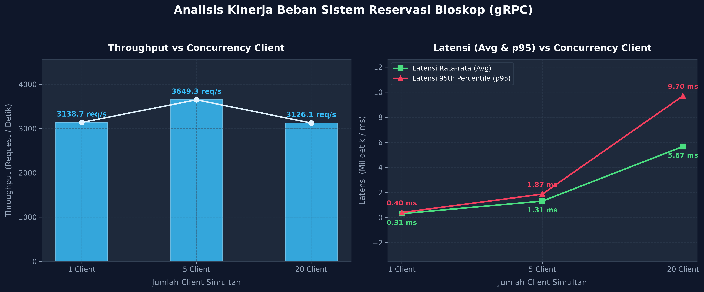

# Bioskop Kita — Reservasi Kursi dengan gRPC

Mini project RPC untuk satu studio dan satu jadwal film. Web menampilkan 50 kursi (baris A–E); perubahan kursi dikirim real-time melalui server-streaming gRPC dan SSE.

## Arsitektur

```text
Browser (HTML/CSS/JS) -- HTTP + SSE --> FastAPI Gateway -- gRPC --> Python gRPC Server
```

Browser memakai HTTP karena browser biasa tidak mendukung gRPC native. Gateway menerjemahkan permintaan web menjadi RPC. Untuk status langsung, gateway berlangganan `PantauKursi` (server streaming) lalu meneruskan pembaruannya ke browser melalui SSE.

## RPC

| RPC | Pola | Fungsi |
|---|---|---|
| `LihatKursi` | Unary | Mengambil status seluruh kursi. |
| `PesanKursi` | Unary | Memesan satu kursi dengan `request_id` idempoten. |
| `PesanBeberapaKursi` | Unary | Memesan beberapa kursi sekaligus secara atomik. |
| `BatalkanPesanan` | Unary | Membatalkan pesanan menggunakan `booking_id`. |
| `PantauKursi` | Server streaming | Mengirim snapshot awal dan snapshot baru saat status berubah. |

Semua akses ke kursi dan data pesanan dilindungi `threading.Condition` (yang juga menyediakan lock). Pengecekan ketersediaan dan perubahan status terjadi di dalam critical section yang sama. Pemesanan beberapa kursi divalidasi sebagai satu transaksi: jika satu kursi saja tidak tersedia, tidak satu pun dipesan. Retry gateway menggunakan ID permintaan yang sama. Hasil operasi disimpan dalam memori untuk deduplikasi.

## Menjalankan dengan Docker

```bash
docker compose up --build
```

Buka `http://localhost:8000`. Untuk demo dua komputer dalam jaringan yang sama, jalankan compose di komputer server lalu buka `http://IP-KOMPUTER-SERVER:8000` dari komputer client. Pastikan firewall mengizinkan port 8000.

## Menjalankan di Windows tanpa Docker

Pakai cara ini kalau perintah `docker` tidak dikenali. Semua perintah di bawah dijalankan dari PowerShell di folder proyek (`D:\KPT Mini Project BIoskop`).

### 1. Pastikan Python tersedia

```powershell
python --version
```

Proyek memerlukan Python 3.10 atau lebih baru. Kalau `python` tidak dikenali, pasang Python dari [halaman resmi Python untuk Windows](https://www.python.org/downloads/windows/). Saat memasang Python, centang **Add python.exe to PATH**, lalu tutup dan buka PowerShell lagi. Setelah itu ulangi `python --version`. Perintah `py` juga bisa dipakai jika Python Launcher terpasang, tetapi langkah berikut menggunakan `python`.

### 2. Buat environment dan pasang dependensi

Jalankan sekali dari folder proyek:

```powershell
python -m venv .venv
.\.venv\Scripts\python.exe -m pip install -r requirements.txt
.\.venv\Scripts\python.exe -m grpc_tools.protoc -I. --python_out=. --grpc_python_out=. proto/bioskop.proto
```

Tunggu setiap perintah selesai tanpa error sebelum menjalankan perintah berikutnya. Langkah `protoc` membuat file stub Python dari `proto/bioskop.proto`.

### 3. Jalankan server dan web gateway

Buka **dua jendela PowerShell** di folder proyek yang sama. Biarkan keduanya tetap terbuka saat aplikasi digunakan.

Di terminal pertama, jalankan server gRPC:

```powershell
.\.venv\Scripts\python.exe server.py
```

Terminal ini seharusnya menampilkan:

```text
Server gRPC berjalan di 0.0.0.0:50051
```

Di terminal kedua, jalankan gateway web:

```powershell
.\.venv\Scripts\python.exe -m uvicorn gateway:app --host 0.0.0.0 --port 8000
```

Terminal ini seharusnya menampilkan bahwa Uvicorn berjalan pada port 8000. Buka **http://localhost:8000** di browser (gunakan `http`, bukan `https`). Untuk menghentikan masing-masing proses, tekan `Ctrl+C` di terminalnya.

### Jika halaman gagal dibuka

- Pastikan kedua terminal masih berjalan dan tidak menampilkan traceback/error.
- Pastikan URL-nya `http://localhost:8000`.
- Jika `python` atau `.venv\Scripts\python.exe` tidak dikenali, kembali ke langkah 1 dan 2; environment `.venv` baru terbentuk jika `python -m venv .venv` berhasil.
- Jika instalasi dependensi atau pembuatan stub gagal, selesaikan error tersebut dulu sebelum menjalankan server.
- Saat minta bantuan, salin error dari terminal gateway dan server. Pesan browser saja biasanya belum menunjukkan proses mana yang gagal.

## Menjalankan lokal tanpa Docker (Linux/macOS)

Gunakan Python 3.10 atau lebih baru:

```bash
python -m venv .venv
# Windows PowerShell:
.venv\Scripts\Activate.ps1
# Linux/macOS:
# source .venv/bin/activate
pip install -r requirements.txt
python -m grpc_tools.protoc -I. --python_out=. --grpc_python_out=. proto/bioskop.proto
```

Jalankan server dan gateway pada dua terminal:

```bash
python server.py
```

```bash
uvicorn gateway:app --host 0.0.0.0 --port 8000
```

Lalu buka `http://localhost:8000`.

## Skenario demo

1. Buka halaman dari dua browser/perangkat.
2. Pilih kursi yang sama dan pesan hampir bersamaan. Hanya satu permintaan yang akan berhasil.
3. Tunjukkan status kursi berubah langsung di browser lainnya.
4. Batalkan pesanan dari panel “Pesanan saya”; kursi kembali tersedia.
5. Untuk pengukuran tugas, jalankan beban 1, 5, dan 20 client. Catat waktu, latensi rata-rata, throughput, lalu bandingkan hasilnya.

## Pengujian Otomatis (Concurrency & Toleransi Kegagalan)

Proyek ini dilengkapi dengan rangkaian pengujian unit dan integrasi terotomasi menggunakan `pytest` untuk membuktikan integritas konkurensi data dan toleransi kegagalan.

### 1. Cakupan Pengujian

- **Concurrency & Race Condition (`tests/test_concurrency.py`)**:
  - `test_perebutan_satu_kursi_20_client`: 20 thread client secara simultan menembak permintaan pemesanan untuk satu kursi yang sama (menggunakan `threading.Barrier`). Membuktikan tepat 1 transaksi berhasil dan 19 transaksi lainnya ditolak dengan pesan valid tanpa race condition.
  - `test_batch_booking_atomik_contention`: Memverifikasi sifat atomik (*all-or-nothing*) pada pemesanan multi-kursi yang saling bertabrakan (`['B1', 'B2']` vs `['B2', 'B3']`), memastikan transaksi yang kalah gagal total dan bebas dari *partial booking*.
  - `test_pesan_dan_batal_simultan`: Simulasi beban intensif operasi pemesanan dan pembatalan simultan untuk membuktikan sistem bebas dari *deadlock* dan tidak mengalami korupsi state data.

- **Toleransi Kegagalan & Idempotensi (`tests/test_toleransi_kegagalan.py`)**:
  - `test_deduplikasi_pesan_kursi_idempotent`: Menguji semantik *At-Most-Once* dengan menembakkan `PesanKursi` menggunakan `request_id` yang sama sebanyak 5 kali. Menghasilkan respons identik dan kursi hanya tercatat satu kali di server.
  - `test_deduplikasi_pesan_batch_idempotent`: Menjamin idempotensi transaksi batch berulang dengan `request_id` sama.
  - `test_deduplikasi_batalkan_pesanan_idempotent`: Menjamin idempotensi pembatalan berulang dengan `request_id` sama.
  - `test_retry_exponential_backoff_handling`: Menguji fungsi `panggil_dengan_retry` pada gateway saat menghadapi gangguan sementara (`UNAVAILABLE`, `DEADLINE_EXCEEDED`) serta verifikasi durasi jeda *exponential backoff*.

### 2. Menjalankan Rangkaian Pengujian

Pasang dependency pengujian dan benchmark sekali dari folder proyek:

```powershell
.\.venv\Scripts\python.exe -m pip install -r requirements-dev.txt
```

Lalu jalankan seluruh test suite:

```powershell
.\.venv\Scripts\python.exe -m pytest tests -v
```

Di macOS/Linux, gunakan perintah berikut:

```bash
python -m pip install -r requirements-dev.txt
python -m pytest tests -v
```

---

## Analisis Kinerja & Pengujian Beban (Benchmark)

Untuk memenuhi rubrik evaluasi kinerja sistem terdistribusi, pengujian beban dilakukan dengan memvariasikan jumlah client simultan (**1, 5, dan 20 client**) sesuai standar evaluasi modul.

### 1. Menjalankan Skrip Benchmark

Skrip benchmark telah didesain mandiri (*self-contained*), secara otomatis menginisialisasi server gRPC terisolasi jika tidak diarahkan ke target eksternal:

```bash
# Menjalankan benchmark standar (1, 5, 20 client)
./.venv/bin/python benchmarks/benchmark.py

# Opsi kustom jika ingin menguji server yang sudah berjalan
./.venv/bin/python benchmarks/benchmark.py --target 127.0.0.1:50051 --requests 200
```

Di Windows PowerShell, jalankan:

```powershell
.\.venv\Scripts\python.exe benchmarks\benchmark.py
```

Skrip akan secara otomatis menghasilkan:
1. Rekapitulasi metrik ke terminal (stdout).
2. Data tabular ke `benchmarks/hasil_benchmark.csv`.
3. Dokumen terstruktur JSON berserta metadata timestamp ke `benchmarks/hasil_benchmark.json`.
4. Grafik visual komparatif beresolusi tinggi ke `benchmarks/grafik_kinerja_kpt.png`.

### Hasil benchmark

Benchmark lokal dijalankan dengan 160 permintaan per skenario. Hasilnya:

| Klien bersamaan | Throughput (req/s) | Rata-rata (ms) | p95 (ms) | p99 (ms) | Error |
|---:|---:|---:|---:|---:|---:|
| 1 | 3.138,69 | 0,31 | 0,40 | 0,49 | 0% |
| 5 | 3.649,30 | 1,31 | 1,87 | 2,53 | 0% |
| 20 | 3.126,07 | 5,67 | 9,70 | 14,33 | 0% |



Pada pengukuran ini, semua skenario selesai tanpa error. Latensi rata-rata dan p95 meningkat saat jumlah klien bertambah; throughput tertinggi tercatat pada 5 klien. Angka ini adalah satu kali pengukuran lokal, sehingga dapat berbeda pada perangkat atau saat pengujian diulang.

## Catatan batasan prototipe

Status dan deduplikasi disimpan di memori. Restart server akan menghapus pesanan dan riwayat request ID. Ini cukup untuk demo concurrency satu server; persistensi database dan deduplikasi lintas restart dapat ditambahkan sebagai pengembangan lanjutan.
